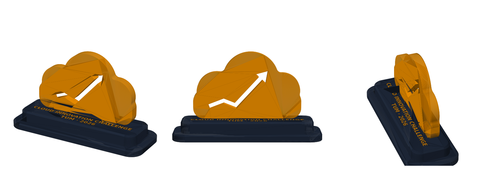

# Cloud Innovation Challenge trophy

A small 3D-printable desk trophy for the Cloud Innovation Challenge at TUM (30 November 2026). The symbol is a cloud with a traffic spike cut through it, a nod to the case: 15 times normal traffic on Black Friday, and a cloud that handles it. The cloud stands on its flat bottom, and two tabs under it slot into a two-step plinth with an engraved label.

It is built the same way as the [n8n trophy](https://github.com/dCartoffel/n8n-trophy): same plinth, same slot fit, same print settings.



- **Size:** 126 × 46 × 73 mm
- **Filament:** about 100 cm³
- **Supports:** none needed for the two-part kit

## Print it

The ready-to-slice files are in [`models/`](models). Open them in any slicer (Bambu Studio, PrusaSlicer, OrcaSlicer, Cura).

| File | What it is |
|---|---|
| `cloud_trophy_symbol.stl` | The cloud. Print it flat. |
| `cloud_trophy_base.stl` | The two-step plinth with two slots. Print it flat. |
| `cloud_trophy_base_2colour.3mf` | Plinth and label as two objects, for multi-colour printers |
| `cloud_trophy_label_inlay.stl` | The label fill on its own |
| `cloud_trophy_onepiece.stl` | Fused version, printed upright |

Print the cloud and the base, then glue the cloud's two tabs into their slots. [PRINTING.md](PRINTING.md) has orientation, slicer settings, assembly and two-colour options.

## Customise it

The models are generated by `make_trophy.py` (Python 3.10+):

```bash
python -m venv .venv
# Windows: .venv\Scripts\activate    macOS/Linux: source .venv/bin/activate
pip install -r requirements.txt
python make_trophy.py models "CLOUD INNOVATION CHALLENGE|TUM · 2026" --design cloud
python render_preview.py models assets/preview.png cloud
```

The second argument is the label text, with `|` between lines. For placings, use for example `"CLOUD INNOVATION CHALLENGE|1ST PLACE · TUM 2026"`. The script prints the resulting cap height. The script also has three alternative symbols (`--design scale`, `zones` or `shield`: a scale-up bar chart, three linked rings for three Availability Zones, and an EU shield), which use the same plinth. At the top of the script you can change the cloud's puffs, the spike, the tab size, both plinth steps, the slot clearance and the engraving depth.

## License and trademark

The code is released under the MIT License (see [LICENSE](LICENSE)).

The cloud symbol is an original design. It does not use the AWS logo or any other AWS trademark, and the project is not affiliated with or endorsed by Amazon Web Services.
